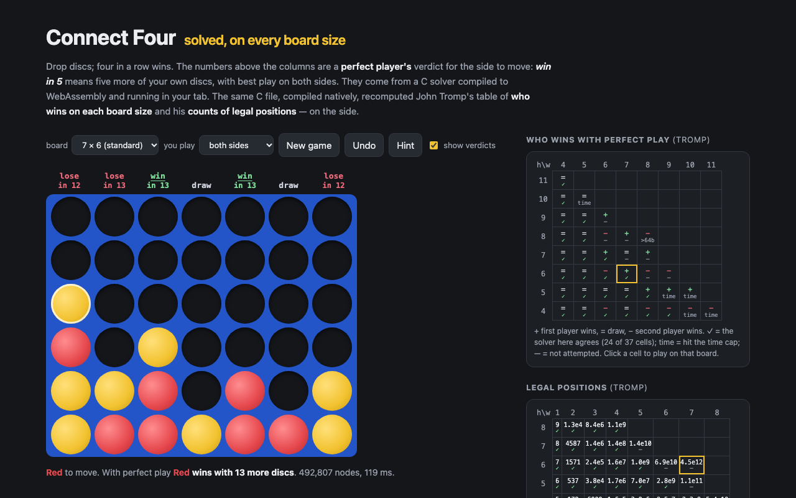

# Connect Four — perfect play on every board size, and Tromp's tables recomputed



Play Connect Four against a perfect player, or watch both sides. Above every column the page shows what a perfect
player would say about dropping a disc there: **win in 5** (five more of your own discs, best play on both sides),
**draw**, or **lose in 12**. Boards from 4×4 to 11×4 are available — every size in John Tromp's table that fits a
64-bit board. Click a cell of the table on the side to switch.

The solver is one C file, [`native/solver.c`](native/solver.c), with no libc. It is compiled twice:

- to **WebAssembly** (17 KB, `clang --target=wasm32` with `zig cc` for the linker, no Emscripten) for the page,
  where it runs in a Web Worker;
- **natively**, to recompute the published tables below.

The search follows Pascal Pons's solver: a bitboard with a spare bit on top of each column, negamax with alpha-beta,
a transposition table holding upper and lower bounds, moves that hand the opponent a win pruned up front, moves
ordered by the number of threats they create, and the exact score found by a series of null-window searches.

## What was recomputed

All published numbers are pulled by `npm run literature` (Tromp's two HTML tables, OEIS A212693, the Wikipedia
sentence) into `tools/literature.json`; `npm run stats` puts each next to the computed value.

**Who wins on each board size** (Tromp, "John's Connect Four Playground"): 24 of the 29 cells attempted agree, none disagrees; 5×10, 9×5, 10×5, 10×4, 11×4 hit the time cap (1,500 s for 10×4, 600 s for the others). Not attempted: 8×6, 9×6, 7×7, 8×7, 6×8, 7×8, 6×9 (Tromp's own runs on boards that wide took thousands of CPU hours); 8×8 doesn't fit 64 bits. 7×6 is a first-player win in 1,953,546,441 nodes.

**7×6 first moves** (Wikipedia, "Connect Four"): all four claims reproduce. Starting in the centre wins on ply 41
(score +1), the two adjacent columns draw, column 1 loses on ply 40 and column 2 on ply 42 (and their mirror images).
Each exact value takes two null-window searches ("is the score above *s*?") instead of the full binary search, which
did not finish in the same time:

| position | question | answer | nodes |
|---|---|---|---|
| empty board | who wins? | first player | 1,953,546,441 |
| empty board | score above 1? | no ⇒ score 1, win on ply 41 | 1,020,689,299 |
| after 1 | who wins? | second player | 157,349,246 |
| after 1 | score above 1? / above 2? | yes / no ⇒ win on ply 40 | 199,603,257 / 247,713,886 |
| after 2 | who wins? | second player | 616,881,905 |
| after 2 | score above 1? | no ⇒ win on ply 42 | 504,026,957 |
| after 3 | who wins? | draw | 706,705,909 |

**Legal positions** (Tromp's second table, boards up to 8 wide): 50 of 55 cells recounted exactly, none disagrees. The other 5 (5×7, 6×6, 7×6, 7×5, 8×4) need 16 GB or more of bitmap even with the compact index.

`native/count.c` marks every reachable position in a bitmap, with several threads running depth-first searches and
claiming positions with an atomic OR. The index is the part that matters: with *k* discs down the first player owns
exactly ⌈*k*/2⌉ of them, so a position is (column heights, *which* ⌈*k*/2⌉ of the *k* discs are the first player's),
ranked with the combinatorial number system. That is 6.0–6.7× smaller (on the four boards that needed it) than giving every column all 2<sup>h+1</sup>−1
contents, and it is what lets 6×5 (9.9 billion indices) and 4×8 (10.1 billion) fit in about 1.3 GB.

**7×6 ply by ply** (OEIS A212693): plies 0–13 recomputed breadth first with one hash set per ply; all 14 terms match.

**The convention.** Tromp's and OEIS's counts stop the game at four in a row. If play continued after a win, 4×4 would
have 187,927 positions instead of 161,029; none of the play-on counts appears in the table.

## Run

```sh
npm install
npm run dev        # http://localhost:5173/portfolio/connect-four/
npm test           # vitest
npm run build      # static files in dist/ (src/c4.wasm is committed)
npm run wasm       # rebuild src/c4.wasm from native/solver.c (needs zig, or CC= a clang with wasm-ld)
```

URL parameters: `?w=7&h=6&moves=4453&you=0` — `moves` lists 1-based columns (10 and 11 are `a`, `b`); `you` is
1 (play first), 2 (play second) or 0 (both sides, analysis only).

In the browser every column gets a budget of 2.5 million nodes for the exact score and another 2.5 million for
win/draw/loss. Early in a 7×6 game that is not enough, and the column shows `?` (the computer then guesses). The
empty 7×6 board uses the native results above. Table entries found before a search runs out stay valid, so the next
position starts with them.

## Recompute the tables

```sh
tools/run-solver.sh 3 600 < tools/jobs.txt       # who wins (10x4 was rerun alone with a 1500 s cap)
tools/run-solver.sh 3 1500 < tools/jobs-7x6.txt  # the 7x6 first moves and the two "score above s?" proofs
tools/run-count.sh 3 1500000000 13               # positions; bitmaps up to 1.5 GB; 7x6 to ply 13
npm run literature
npm run stats                                    # → src/stats.json
```

Every run's output is committed in `tools/runs/`. The node counts are deterministic; the seconds are not (the
machine was shared, see below). The tests check the WebAssembly solver against a naive memoised full search in
TypeScript (exact scores of random positions on 4×4, 5×4, 4×5 and late 7×6 positions, per column), the empty-board
values of nine small boards, the TypeScript position enumeration against the C logs and Tromp, the play-on count,
A212693, and the node budget.

A note on the runs: the first attempt ran nine solvers at once with a 300 MB transposition table each. The machine
compressed their memory and everything ran about 100× slower than alone (4×8: 150 s instead of 1.4 s). With a 72 MB
table and three at a time, 4×8 took 1.6 s again.

## License

MIT © SEN LLC

<!-- sen-publish:links -->
## Links

- 🌐 Demo: https://sen.ltd/portfolio/connect-four/
- 📝 記事: https://qiita.com/sen-ltd/items/3bd59b295d481a2ef4c0
<!-- /sen-publish:links -->
